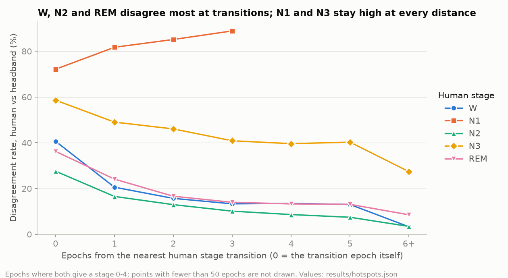
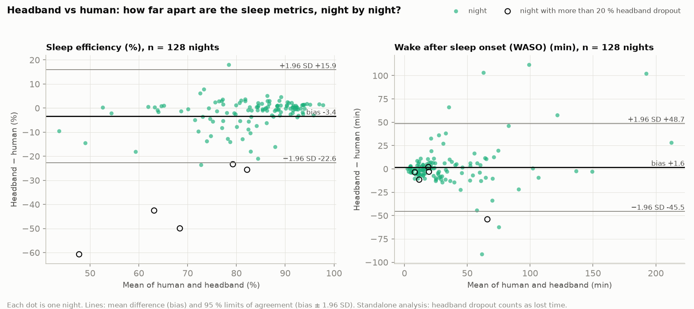
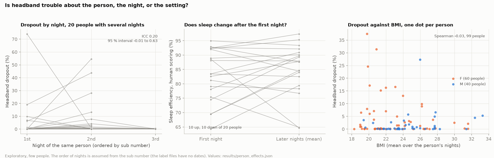
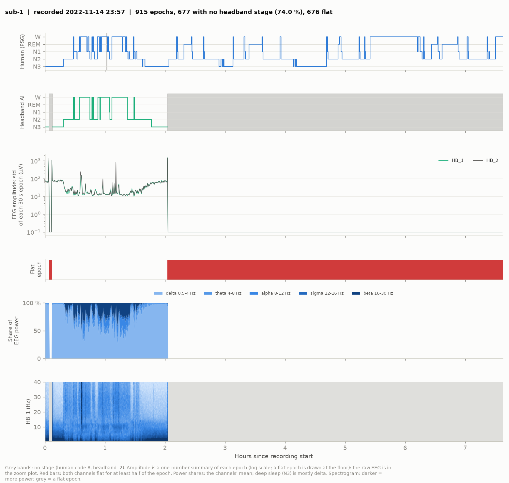
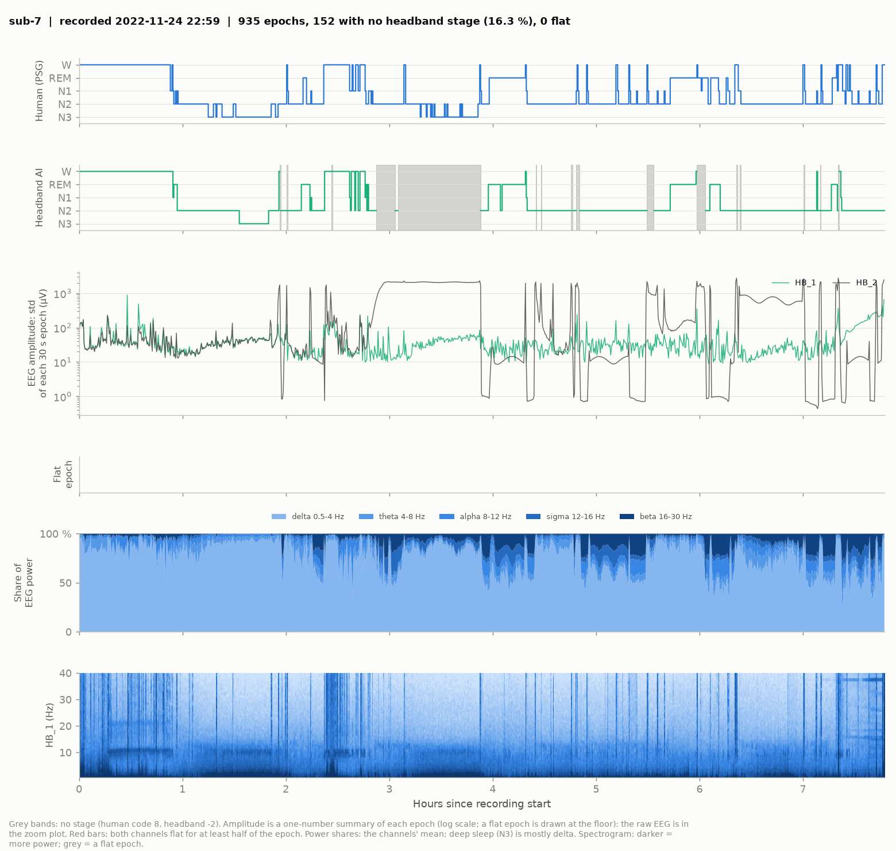
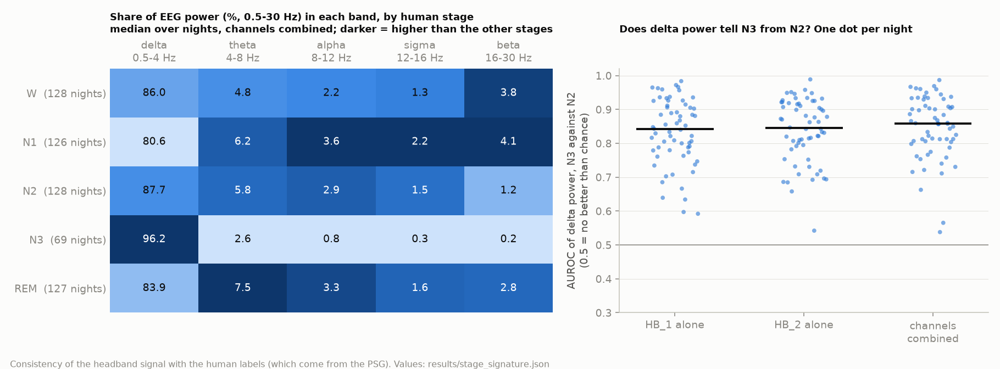
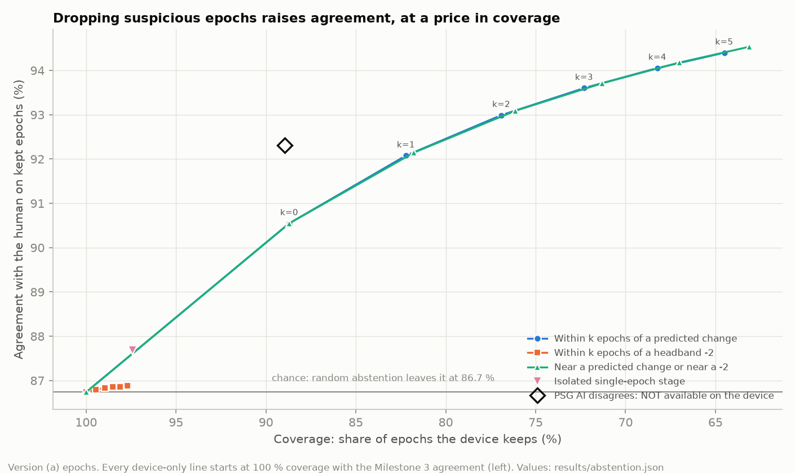
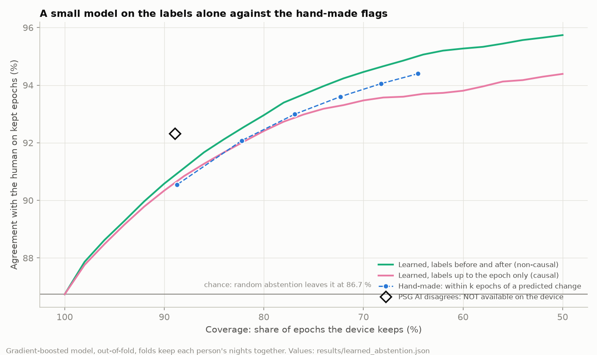

# Where a wearable headband is uncertain, and how to flag it

Phase 0: a label-only analysis of the Bitbrain Open Access Sleep (BOAS) dataset. *This file is generated by `src/boas_unc/report.py`. Do not edit it by hand.*

## Summary

- **Agreement.** Where the headband AI gives a stage, it agrees with the human consensus on 86.7% of epochs (Cohen's kappa 0.77), against 87.1% for the AI run on the PSG. When an epoch with no headband stage counts as an error, the headband figure is 83.2%.
- **Where it is uncertain.** N1 is the hardest stage: 74.2% of its epochs disagree, most often because the headband says N2 (36.9% of the N1 epochs). Disagreement is 43.7% on the epochs on either side of a human stage change and 4.9% 6+ epochs away from one.
- **Clinical metrics.** Night by night, the headband's total sleep time differs from the human's by -17.0 min on average (limits of agreement -110 to 76 min) and its sleep efficiency by -3.4 points. On the same 128 nights, restricted to epochs where both give a stage, the total sleep time difference is -1.2 min, so most of the sleep-time gap comes from epochs where the headband gives no stage.
- **The raw signal.** Of the 4,881 epochs without a headband stage, 56.4% have both channels flat and 38.9% have exactly one clean channel. A flat signal is not always flagged: 315 flat epochs have a headband stage.
- **How to flag it.** Setting aside the epochs within one epoch of a predicted stage change leaves 82.2% of the epochs, with 92.1% agreement on those, from 86.7% before flagging. The flag uses the headband labels only.

## Dataset and data used

- **Dataset:** The Bitbrain Open Access Sleep (BOAS) dataset. DOI `doi:10.18112/openneuro.ds005555.v1.1.3`, licence CC0. Authors: Eduardo López-Larraz, María Sierra-Torralba, Sergio Clemente, Galit Fierro, David Oriol, Javier Minguez, Luis Montesano, and Jens G. Klinzing.
- **Content:** 128 nights from 100 people (some people were recorded on more than one night), 120,095 epochs of 30 s. Nights last 3.4 to 9.3 h (median 7.8 h). Every night was recorded at the same time with a clinical polysomnography (PSG) and with the headband.
- **People:** ages 18 to 82, median 31 over the 99 people with a known age (one value per person, the mean over their nights; 1 person has no recorded age). Counted by night instead, the median age is 33, because people in the older age bands contributed more nights. By sex: 60 F, 40 M. Participants were members of the general population. Patients were not recruited, and severe medical, neurological or psychiatric conditions were exclusion criteria (dataset README).
- **Labels used:** the human consensus on the PSG (the reference), the AI label computed from the PSG, and the AI label computed from the headband. Most of the analysis uses only these label files. One section reads the headband's own EEG, never the PSG signals.
- **Special codes:** the humans mark stretches where the PSG was disconnected (code 8). The AI marks epochs it cannot stage as artefact or missing (code -2). Both are kept on the timeline and handled by explicit rules.

## Methods

- The human consensus label is the reference. The AI labels come with the dataset, and no model was trained here.
- Labels are joined across files by epoch onset time, never by row order. Every epoch stays on the full timeline.
- Agreement is reported in three versions: (a) epochs where both labels are a stage, (b) the same with a missing headband stage counted as an error, (c) coverage, the share of reference epochs where the AI gives a stage.
- Epochs where the PSG was disconnected are left out of every comparison, because the humans had no signal either.
- Disagreement hotspots use version (a): by true stage, by distance to the nearest human stage change, next to headband no-stage epochs, by hour of the night, by person, age band and sex.
- Clinical sleep metrics follow AASM-style definitions written down before implementation (`docs/definitions.md`). The main analysis keeps each sequence on its own timeline, so headband dropout shows up as lost sleep time. A matched-epoch analysis restricts both sequences to epochs where both give a stage.
- Per-night differences are summarised with the mean bias and limits of agreement (bias plus or minus 1.96 standard deviations, covering about 95% of nights), correlation, and the median and IQR over nights.
- Device-only flags are computed from the headband label sequence alone: near a predicted stage change, isolated single-epoch stage, near a missing-stage epoch. Their ranges were fixed before any result was computed.
- Distributions are over nights. Comparisons between groups use the person as the unit, because some people contributed several nights.
- Every number in this report is generated from `results/*.json` by `src/boas_unc/report.py`.

## Agreement

| Pair (reference first) | Epochs, version (a) | Accuracy (a) | Kappa (a) | Accuracy (b) | Coverage (c) | Per-night accuracy (a), median (IQR) |
|---|---|---|---|---|---|---|
| Human vs AI on PSG | 119,389 | 87.1% | 0.78 | 86.9% | 99.7% | 88.7% (85.8 to 91.3) |
| Human vs AI on headband | 114,890 | 86.7% | 0.77 | 83.2% | 95.9% | 88.4% (84.8 to 91.1) |
| AI on PSG vs AI on headband (analysis only) | 114,578 | 89.2% | 0.81 | 85.6% | 96.0% | 89.9% (87.3 to 92.2) |

For the same two comparisons the dataset README reports 87.13% and 86.71%. This analysis gets 87.13% and 86.74%, within 0.03 points, so the label files, the alignment and the stage mapping match the published figures. The small remaining difference is consistent with the label revision noted in the dataset changelog.

Per stage, human as the reference (version (a), pooled over all epochs):

| Stage | Human epochs | Headband precision | Headband recall | Headband F1 | PSG AI F1 |
|---|---|---|---|---|---|
| W | 18,312 | 86.3% | 87.7% | 87.0% | 87.1% |
| N1 | 4,306 | 50.4% | 25.8% | 34.1% | 38.3% |
| N2 | 69,375 | 90.7% | 92.2% | 91.4% | 91.7% |
| N3 | 4,817 | 69.1% | 58.4% | 63.3% | 68.1% |
| REM | 18,080 | 80.8% | 87.0% | 83.8% | 84.7% |

The AI on the headband and the AI on the PSG have the same shape across stages. The pair in the last row of the first table compares two AI outputs with each other. It is an analysis tool and not a deployable check, because a home user has no PSG.

## Wake, light and deep sleep

A closed-loop stimulation system does not need all five stages: it needs to know whether the person is awake, in light sleep or in deep sleep. Mapping the stages to those three (wake is W, light is N1, N2 and REM, deep is N3, which is an assumption about such a classifier), the headband agrees with the human on 93.0% of the 114,890 epochs where both give a stage. By the class the human scored:

| Human class | Epochs | Headband: wake | Headband: light | Headband: deep |
|---|---|---|---|---|
| Wake | 18,312 | 87.7% | 12.2% | 0.0% |
| Light | 91,761 | 2.8% | 95.9% | 1.4% |
| Deep | 4,817 | 0.3% | 41.3% | 58.4% |

Deep sleep is the weak point: the headband finds 58.4% of the human's deep epochs (precision 69.1%), and 53.8% when an epoch with no headband stage counts as missed. Almost all misses are called light sleep. Of the 4,068 epochs where the headband says deep, the human scored 0.15% as awake, 30.8% as light sleep (N2 in 30.7% of all such epochs) and 69.1% as deep. So a deep-sleep call that is wrong is almost always light sleep, rarely wakefulness.

Per night, among the 61 nights with enough human deep sleep, the median share of it that the headband finds is 0.59 (IQR 0.23 to 0.80), and in 9 of those nights it finds none of it. Leaving out every epoch where either label is REM changes little (accuracy 92.4%, deep recall 58.4%). This uses the dataset's own headband labels, which may not come from the same classifier that a stimulation system uses.

## Where the disagreements are

Overall, 13.3% of the 114,890 epochs where both give a stage disagree. The rate by the stage the human scored:

| Human stage | Epochs | Disagreement | Per night, median (IQR) | Most common headband label instead |
|---|---|---|---|---|
| W | 18,312 | 12.3% | 11.3% (5.5 to 20.2) | N2 (6.2%) |
| N1 | 4,306 | 74.2% | 73.9% (61.5 to 85.0) | N2 (36.9%) |
| N2 | 69,375 | 7.8% | 5.1% (2.3 to 10.0) | REM (3.7%) |
| N3 | 4,817 | 41.6% | 41.5% (18.4 to 88.5) | N2 (41.3%) |
| REM | 18,080 | 13.0% | 9.5% (4.2 to 17.8) | N2 (10.4%) |

*Figure A. Disagreement between the human and the headband against the distance, in epochs, to the nearest human stage change, one line per human stage. Points with too few epochs are not drawn.*

By distance to the nearest human stage change, all stages together. The last column is the share of the human's staged epochs where the headband gives no stage, which version (a) leaves out of the rate:

| Distance (epochs) | Epochs | Disagreement | Headband gives no stage |
|---|---|---|---|
| transition epoch | 15,540 | 43.7% | 4.6% |
| 1 | 8,220 | 24.7% | 4.4% |
| 2 | 6,523 | 17.8% | 4.5% |
| 3 | 5,693 | 13.7% | 4.3% |
| 4 | 5,100 | 11.8% | 4.3% |
| 5 | 4,611 | 10.8% | 4.6% |
| 6+ | 69,203 | 4.9% | 3.8% |

Next to an epoch where the headband gives no stage (-2), looking at the epochs just before and just after:

| Distance to the flag | Epochs before | Disagreement before | Epochs after | Disagreement after |
|---|---|---|---|---|
| no flag within the range | 112,256 | 13.1% |  |  |
| 1 epoch(s) away | 356 | 22.8% | 301 | 26.2% |
| 2 epoch(s) away | 330 | 21.5% | 274 | 21.9% |
| 3 epoch(s) away | 316 | 19.3% | 258 | 19.8% |
| 4 epoch(s) away | 299 | 14.7% | 241 | 18.3% |
| 5 epoch(s) away | 288 | 17.7% | 230 | 19.1% |

By hour since the recording start (late hours rest on few nights):

| Hour | Nights | Epochs | Disagreement |
|---|---|---|---|
| 0 | 128 | 15,136 | 12.6% |
| 1 | 128 | 15,149 | 16.0% |
| 2 | 128 | 14,931 | 14.1% |
| 3 | 126 | 14,749 | 13.4% |
| 4 | 125 | 14,747 | 9.9% |
| 5 | 125 | 14,774 | 11.3% |
| 6 | 124 | 14,292 | 12.6% |
| 7 | 110 | 8,803 | 17.1% |
| 8 | 45 | 2,267 | 17.0% |
| 9+ | 2 | 42 | 4.8% |

Per person, the median night-level disagreement is 11.8% (9.2 to 14.9) over 100 people. By age band and sex, with the person as the unit:

| Group | People | Nights | Per-person disagreement, median (IQR) |
|---|---|---|---|
| Age 18-29 | 47 | 54 | 13.3% (11.0 to 16.5) |
| Age 30-44 | 25 | 27 | 10.2% (8.3 to 13.1) |
| Age 45-59 | 8 | 8 | 10.0% (8.2 to 12.4) |
| Age 60+ | 19 | 38 | 11.1% (9.4 to 13.6) |
| Sex F | 60 | 76 | 11.3% (9.1 to 14.3) |
| Sex M | 40 | 52 | 13.0% (10.2 to 16.0) |

The groups overlap heavily and no statistical test was run, so these are descriptions and not findings.

## Clinical sleep metrics, night by night

Each of the 128 nights gives one value per metric from the human labels and one from the headband labels, each on its own timeline, so epochs with no headband stage count as lost time. Differences are headband minus human. Limits of agreement are the bias plus or minus 1.96 standard deviations of the differences.

| Metric | Nights | Human, median (IQR) | Headband, median (IQR) | Mean bias | Limits of agreement | Median per-night difference (IQR) | Pearson r |
|---|---|---|---|---|---|---|---|
| Total sleep time (min) | 128 | 402.0 (366.2 to 432.0) | 391.0 (353.0 to 416.6) | -17.0 | -110.2 to 76.3 | -2.2 (-16.1 to 5.0) | 0.74 |
| Sleep efficiency (%) | 128 | 86.0 (79.6 to 91.3) | 84.5 (74.5 to 90.6) | -3.4 | -22.6 to 15.9 | -0.5 (-3.6 to 1.1) | 0.69 |
| Sleep onset latency (min) | 127 | 27.0 (15.2 to 47.0) | 22.5 (12.8 to 47.0) | -2.1 | -26.0 to 21.9 | 0.0 (-2.5 to 1.5) | 0.91 |
| Wake after sleep onset (WASO) (min) | 128 | 19.0 (13.0 to 45.9) | 23.0 (11.9 to 44.1) | +1.6 | -45.5 to 48.7 | -0.8 (-6.6 to 5.1) | 0.80 |
| REM latency (min) | 127 | 102.0 (73.8 to 155.0) | 60.0 (1.5 to 100.8) | -57.8 | -207.0 to 91.5 | -31.5 (-101.8 to -0.5) | 0.41 |
| Terminal wake (min) | 128 | 1.5 (0.5 to 5.5) | 0.5 (0.0 to 3.5) | -1.1 | -17.7 to 15.5 | -0.5 (-1.0 to 0.0) | 0.87 |
| N1, share of sleep (%) | 128 | 3.8 (2.6 to 5.6) | 2.0 (1.2 to 3.0) | -2.3 | -8.4 to 3.8 | -1.7 (-2.7 to -0.7) | 0.39 |
| N2, share of sleep (%) | 128 | 72.2 (67.9 to 75.9) | 74.3 (67.0 to 79.2) | +1.6 | -14.9 to 18.1 | 1.6 (-2.9 to 5.5) | 0.48 |
| N3, share of sleep (%) | 128 | 2.0 (0.0 to 8.1) | 0.7 (0.0 to 6.7) | -0.8 | -11.4 to 9.7 | -0.1 (-2.8 to 0.0) | 0.69 |
| REM, share of sleep (%) | 128 | 19.6 (14.2 to 22.7) | 20.0 (15.9 to 24.0) | +1.5 | -11.1 to 14.2 | 0.8 (-1.3 to 4.0) | 0.55 |

*Figure B. Bland-Altman plots for sleep efficiency and wake after sleep onset (WASO). Each dot is one night. Open circles are nights with a high share of headband dropout.*

**How much of the gap is headband dropout?** Restricting both sequences to the epochs where both give a stage (the matched-epoch analysis, leaving out the 5 nights with a high dropout share), the bias shrinks:

| Metric | Bias, own timelines | Bias, matched epochs | Limits of agreement, matched |
|---|---|---|---|
| Total sleep time (min) | -17.0 | -1.1 | -41.2 to 39.1 |
| Sleep efficiency (%) | -3.4 | -0.2 | -9.0 to 8.7 |
| N1, share of sleep (%) | -2.3 | -2.3 | -8.5 to 4.0 |
| N2, share of sleep (%) | +1.6 | +1.4 | -14.2 to 17.1 |
| N3, share of sleep (%) | -0.8 | -0.7 | -10.7 to 9.3 |
| REM, share of sleep (%) | +1.5 | +1.5 | -10.1 to 13.2 |

On all 128 nights the matched-epoch biases are -1.2 min for total sleep time and -0.2 points for sleep efficiency. The dropout is concentrated: 5 nights (sub-1, sub-13, sub-57, sub-61, sub-77) have more than 20% of their time with no headband stage.

**REM latency.** With the first REM epoch as the definition, the mean bias is -57.8 min and the median per-night difference -31.5 min (127 nights). Requiring a run of at least 3 REM epochs on both sides changes the mean bias to -40.2 min and the median per-night difference to -3.0 min. A typical night is then close to the human value, and a tail of nights where the headband reaches sustained REM much earlier keeps the mean bias large. The labels alone cannot say whether those stretches are wrong or whether the human scorers called the same epochs N1 or N2.

**Metrics piled up at zero.** For some metrics many nights have exactly zero in one or both sequences. In a Bland-Altman plot those nights fall on straight diagonal lines, so the limits of agreement describe these metrics poorly, and the per-night distributions above are more informative.

| Metric | Nights | Both zero | Headband zero, human above | Human zero, headband above |
|---|---|---|---|---|
| REM latency (min) | 127 | 0 | 21 | 0 |
| Terminal wake (min) | 128 | 19 | 43 | 3 |
| N3, share of sleep (%) | 128 | 30 | 26 | 7 |

## Is the trouble about the person, the night or the setting?

Exploratory, label only, and based on the people who were recorded more than once. 20 people have 48 nights between them. Because the dataset has no recording dates, a person's nights are ordered by the number in the recording name, which is an assumption.

**Dropout.** The intraclass correlation of the dropout share is 0.20 (95% interval -0.01 to 0.63), and the correlation between nights of the same person is -0.01 over 36 pairs. The interval is wide. A moderate person effect can't be ruled out, but these data do not support one. The nights with a high dropout share and the same person's other nights:

| Night | Dropout | The person's other nights |
|---|---|---|
| sub-1 | 74.1% | sub-2 0.8% |
| sub-13 | 54.6% | sub-10 0.0% |
| sub-57 | 43.7% | sub-55 19.0% |
| sub-61 | 28.1% | sub-59 6.2% |
| sub-77 | 24.6% | no other night |

*Figure D. Left: dropout in each night of the people recorded more than once. Middle: human sleep efficiency on the first night and on later nights. Right: dropout against BMI, one dot per person.*

**First nights against later nights.** For each person, the later nights (their mean) minus the first night. The last two columns are the number of people where it goes up, down or stays the same, and an exploratory Wilcoxon p-value.

| Measure | People | Median difference (IQR) | Up / down / same | p |
|---|---|---|---|---|
| Disagreement rate (points) | 20 | -1.9 (-6.2 to 1.9) | 8 / 12 / 0 | 0.29 |
| Headband dropout (points) | 20 | 0.4 (-0.1 to 3.2) | 13 / 6 / 1 | 0.12 |
| Sleep efficiency, human (points) | 20 | 0.5 (-2.3 to 8.5) | 10 / 10 / 0 | 0.41 |
| Sleep onset latency, human (min) | 19 | -5.8 (-11.5 to 13.5) | 7 / 12 / 0 | 0.83 |
| WASO, human (min) | 20 | -4.9 (-39.8 to 6.5) | 7 / 13 / 0 | 0.25 |
| REM share of sleep, human (points) | 20 | 1.4 (-0.7 to 4.0) | 13 / 7 / 0 | 0.23 |

**Sex, BMI and age.** With the person as the unit. The comparison by sex is a Mann-Whitney test, the others are Spearman correlations. Many comparisons are made, so p-values are for orientation only.

| Outcome | By sex (median) | p by sex | BMI: Spearman rho | Age: Spearman rho |
|---|---|---|---|---|
| Headband dropout | F 0.91%, M 0.26% (people: 60 and 40) | 0.09 | -0.03 (p 0.76, 99 people) | 0.06 (p 0.58, 99 people) |
| Disagreement rate | F 11.31%, M 12.95% (people: 60 and 40) | 0.28 | -0.01 (p 0.93, 99 people) | -0.25 (p 0.01, 99 people) |

Across the 12 comparisons in this section the smallest p-value is 0.013 (disagreement rate against age). With that many comparisons, the level to reach is about 0.0042 (the usual level divided by their number), so the smallest is above it. The data cannot separate band fit, sweat and movement. That needs the headband's movement sensor and the signals.

## What the raw headband signal shows

Up to here the analysis used labels only. This part reads the headband's own EEG, both channels, in all 128 nights, and compares it with the labels. Only files that match their published checksum were used, read-only. The PSG signals were not read, so the human labels cannot be checked against them here.

**What is behind a no-stage epoch.** 4,881 epochs in 100 nights get no headband stage. In 56.4% of them both channels are flat (constant, for at least half of the epoch). Looking at each channel against the night's own typical amplitude (the main thresholds below), the rest are mostly nights where one channel is wild or nearly silent while the other is clean. On the dead-signal nights, the signal looks normal until a large transient, then sits at a constant value (the bottom of the file's range) for hours: see the first example night.

| Epochs with no headband stage | Both channels clean | One channel clean, one bad | Both channels bad | Share of one-clean-channel epochs that get no stage |
|---|---|---|---|---|
| main thresholds (bad at 10 times or 0.1 times the night's typical amplitude) | 1.9% | 38.9% | 59.2% | 33.4% |
| stricter thresholds (bad at 5 times or 0.2 times the night's typical amplitude) | 0.7% | 37.7% | 61.5% | 25.6% |

When exactly one channel is bad, it is HB_1 in 62.9% of the no-stage cases and HB_2 in 37.1%. In total, 948 of the 2,440 minutes without a stage had one clean channel, spread over few nights (median 0.0 minutes per night with a no-stage epoch). Whether the clean channel alone would stage well is not tested here. The Bitbrain paper reports that a single frontal channel stages nearly as well as two on public datasets.

Agreement of the headband stage with the human, by how clean the signal is (epochs where both give a stage, in brackets):

| Thresholds | Both channels clean | One channel clean, one bad | Both channels bad |
|---|---|---|---|
| main thresholds | 87.1% (110,361) | 81.2% (3,768) | 65.8% (761) |
| stricter thresholds | 87.2% (107,690) | 80.7% (5,322) | 74.9% (1,878) |

**A dead signal is not always flagged.** 315 of the 3,070 flat epochs (10.3%) have a headband stage, in 3 nights. The three nights with the most are sub-96 (237 epochs), sub-82 (50 epochs), sub-44 (28 epochs). In some of them the signal is completely flat and the stage is held constant for a long stretch, which a user could read as sleep.

*Figure F. A night with a dead signal from about the second hour (first), and a night where one channel is wild for hours while the other stays clean (second). Each overview shows the human and headband stages, the EEG amplitude, flat epochs, the share of power by band, a spectrogram and movement when the night has it.*

**Does the signal carry what the human labels imply?** Across 128 nights, the share of EEG power in each band, by the stage the human scored (the channels' mean):

| Human stage | Nights | Delta (0.5-4 Hz) | Theta (4-8 Hz) | Alpha (8-12 Hz) | Sigma (12-16 Hz) | Beta (16-30 Hz) |
|---|---|---|---|---|---|---|
| W | 128 | 86.0% | 4.8% | 2.2% | 1.3% | 3.8% |
| N1 | 126 | 80.6% | 6.2% | 3.6% | 2.2% | 4.1% |
| N2 | 128 | 87.7% | 5.8% | 2.9% | 1.5% | 1.2% |
| N3 | 69 | 96.2% | 2.6% | 0.8% | 0.3% | 0.2% |
| REM | 127 | 83.9% | 7.5% | 3.3% | 1.6% | 2.8% |

*Figure G. Left: the table above as a heatmap, each band shaded across the stages. Right: how well delta power tells N3 from N2 within a night (higher is better, and chance level is the same as a coin flip), for each channel and for both.*

How well each feature separates two stages within a night (median over nights of the area under the ROC curve; a value above one half means the feature is higher in the first stage, and below one half higher in the second):

| Contrast | Nights | delta | theta | alpha | sigma | beta | amplitude |
|---|---|---|---|---|---|---|---|
| N3 against N2 | 62 | 0.86 | 0.21 | 0.14 | 0.08 | 0.07 | 0.85 |
| N2 against N1 | 103 | 0.63 | 0.49 | 0.40 | 0.41 | 0.20 | 0.58 |
| REM against N2 | 126 | 0.40 | 0.58 | 0.55 | 0.54 | 0.76 | 0.38 |
| Wake against sleep | 127 | 0.49 | 0.38 | 0.45 | 0.45 | 0.72 | 0.66 |

This checks consistency with the human labels, which were made on the PSG with eye and chin channels that the headband lacks. It cannot show that those labels are right.

**The two channels agree.** Per night, the median correlation between them is 0.85 for amplitude and 0.85 for delta share, so a second channel adds little on a good night. Its value is as a fallback.

**Amplitude spikes.** Epochs with an amplitude of at least three times the night's typical amplitude are 6.8% of live epochs:

| Human stage | Share of spike epochs | Share of all live epochs | Ratio |
|---|---|---|---|
| W | 42.6% | 16.0% | 2.7 |
| N1 | 3.3% | 3.7% | 0.9 |
| N2 | 36.5% | 60.2% | 0.6 |
| N3 | 6.1% | 4.3% | 1.4 |
| REM | 11.5% | 15.7% | 0.7 |

Their correlation with the movement sensor is 0.23 (median over the 94 nights that have it).

**Is a dropout preceded by movement?** In 94 nights with a movement sensor there are 46 stretches of at least five minutes without a stage that follow staged epochs. Compared with the same night's other five-epoch windows, the movement just before such a stretch has a median rank of 0.61 (a rank of one half would be typical movement). Large movement at the very end of a night often marks the band being taken off.

**Order of nights.** For all 20 people recorded on more than one night, the order of the recording start dates in the EDF headers matches the order of the recording numbers in 20 cases, so the first-night analyses above did use the real order.

## How to flag the uncertain epochs

A flag marks an epoch that should not be trusted. The flags below use the headband label sequence alone, so a wearable could compute them on the device. Agreement is measured against the human on the epochs that are kept, starting from 86.7% with no flag. Random abstention leaves that figure unchanged.

| Flag | Coverage (share kept) | Agreement on kept epochs | Share of disagreements flagged | Per-night agreement, median (IQR) |
|---|---|---|---|---|
| No abstention (baseline) | 100.0% | 86.7% | 0.0% | 88.4% (84.8 to 91.1) |
| Isolated single-epoch stage | 97.4% | 87.7% | 9.6% | 89.3% (85.4 to 92.3) |
| On a predicted stage change | 88.7% | 90.5% | 36.8% | 92.2% (88.1 to 94.7) |
| Within 1 epoch of a predicted stage change | 82.2% | 92.1% | 50.9% | 93.6% (89.6 to 96.2) |
| Within 3 epochs of a predicted stage change | 72.3% | 93.6% | 65.1% | 95.1% (91.1 to 97.5) |
| Within 5 epochs of a predicted stage change | 64.5% | 94.4% | 72.8% | 95.8% (92.2 to 98.1) |
| Within 2 epochs of a headband no-stage (-2) epoch | 99.0% | 86.8% | 1.7% | 88.5% (84.5 to 91.2) |
| Within 1 epoch of a predicted change or a -2 | 81.8% | 92.1% | 51.6% | 93.6% (89.6 to 96.2) |
| PSG AI disagrees (NOT available on the device) | 88.9% | 92.3% | 48.4% | 93.6% (90.6 to 95.5) |

*Figure C. Agreement with the human on the epochs that are kept, against the share of epochs kept, as the flag range k grows. The hollow diamond uses the PSG AI and is not available on the device. It is shown as a reference for what a second opinion from the PSG adds.*

**Smoothing.** Replacing each isolated epoch whose two neighbours agree with their label changes 1.0% of the epochs. Agreement stays at 86.74% (kappa 0.769 to 0.769). Effect on a few clinical metrics (absolute mean bias, and median absolute per-night error, before to after):

| Metric | Absolute bias | Median absolute error |
|---|---|---|
| Sleep efficiency (%) | 3.37 to 3.34 | 2.05 to 2.03 |
| Sleep onset latency (min) | 2.07 to 0.59 | 2.00 to 2.00 |
| Wake after sleep onset (WASO) (min) | 1.62 to 0.24 | 6.00 to 6.00 |
| REM latency (min) | 57.77 to 53.94 | 38.50 to 29.00 |

**Leaving flagged epochs out.** Both sequences are computed on the kept epochs only. This measures staging agreement on those epochs, not how well the whole-night value is recovered from part of the night. Median absolute per-night error, before to after:

| Flag | Share of matched time kept | Sleep efficiency (points) | N3 share of sleep (points) |
|---|---|---|---|
| Isolated single-epoch stage | 97.4% | 1.23 to 1.13 | 1.18 to 1.15 |
| Within 1 epoch of a predicted stage change | 82.2% | 1.23 to 0.61 | 1.18 to 0.95 |
| Within 2 epochs of a headband no-stage (-2) epoch | 99.0% | 1.23 to 1.19 | 1.18 to 1.11 |
| Within 1 epoch of a predicted change or a -2 | 81.8% | 1.23 to 0.61 | 1.18 to 0.93 |
| PSG AI disagrees (NOT available on the device) | 88.9% | 1.23 to 0.65 | 1.18 to 0.65 |

The flag for epochs near a predicted stage change does most of the work. The flags for epochs near a missing-stage epoch change little, because few epochs sit near one.

**A model on the labels alone.** Can a small model, trained on the headband's label sequence and the clock only, predict where the headband is wrong better than the hand-made flags? Five folds keep every night of one person together, every score is out of fold, and nothing was tuned. The causal version sees only the labels up to the epoch, so it could run in real time. The other sees labels on both sides. The first table is the ability to separate errors from correct epochs (AUROC: the chance that a wrong epoch is ranked above a correct one, higher is better, and chance level is the same as a coin flip):

| Predictor | Kind | AUROC |
|---|---|---|
| Isolated single-epoch stage | hand-made | 0.54 |
| On a predicted stage change | hand-made | 0.65 |
| Within 1 epoch of a predicted stage change | hand-made | 0.69 |
| Within 3 epochs of a predicted stage change | hand-made | 0.72 |
| Within 2 epochs of a headband no-stage (-2) epoch | hand-made | 0.50 |
| PSG AI disagrees (NOT available on the device) | hand-made | 0.72 |
| Learned, labels up to the epoch | logistic regression | 0.72 |
| Learned, labels up to the epoch | gradient boosting | 0.76 |
| Learned, labels before and after | logistic regression | 0.77 |
| Learned, labels before and after | gradient boosting | 0.80 |

Agreement on kept epochs at the same coverage as each hand-made flag:

| Hand-made flag | Coverage | Hand-made agreement | Learned, up to the epoch | Learned, both sides |
|---|---|---|---|---|
| On a predicted stage change | 88.7% | 90.55% | 90.69% | 90.93% |
| Within 1 epoch of a predicted stage change | 82.2% | 92.08% | 92.00% | 92.50% |
| Within 3 epochs of a predicted stage change | 72.3% | 93.60% | 93.30% | 94.19% |
| Within 5 epochs of a predicted stage change | 64.5% | 94.40% | 93.64% | 95.01% |
| PSG AI disagrees (NOT available on the device) | 88.9% | 92.31% | 90.61% | 90.87% |

*Figure E. Agreement on kept epochs against coverage for a gradient-boosted model trained on the labels alone, against the hand-made flags. The hollow diamond uses the PSG AI and is not available on the device.*

Compared with the hand-made flags at the same coverage, the learned model that sees both sides changes agreement by +0.4 to +0.6 points across the device-only flags. The simple flags already use most of what the labels can tell. A larger gain needs information from the signal, for example the model's probabilities or a signal-quality measure.

## Limitations

- **Hard labels only.** The dataset provides one stage per epoch and no probabilities, so this report can say where the labels disagree and which simple flags help, but not how confident the model is.
- **The reference is a consensus, not the truth.** The human label is the majority of three scorers. The dataset README puts the agreement between human scorers at about 82%, so some of the disagreement measured here is uncertainty in the reference itself.
- **Population.** The participants are 100 adults from the general population, without recruited patients and with severe conditions excluded. The results may not carry over to people with sleep disorders, to other age groups or to home recordings.
- **Repeated nights.** 128 nights come from 100 people. Night-level statistics treat nights as independent. Group comparisons use the person as the unit, and the groups are small.
- **Possible optimism in the AI labels.** The README states that cross-validation was used for the AI labels, but not whether the folds kept all nights of one person together. If the folds mixed nights of one person, the agreement would be somewhat optimistic.
- **PSG-based flags are not deployable.** The comparison between the AI on the PSG and the AI on the headband needs a PSG recording. A home user wears only the headband. It is reported as a reference and not as a feature.
- **Dropout is handled in two ways.** The main analysis counts epochs with no headband stage as lost time, the matched-epoch analysis leaves them out. Which one answers a given question depends on whether the dropout itself is part of what is being judged.
- **Definitions matter.** For example REM latency changes noticeably with the rule for what counts as the first REM epoch. All definitions are written in `docs/definitions.md`.
- **Heuristic flags.** They were fixed in advance and not tuned, but they are evaluated on the same nights as everything else. A calibrated probability should be compared against them as a baseline.
- **How the BOAS labels were made is not documented in the paper cited by the README.** That paper uses other open datasets. Whether the shipped labels come from the real-time or the offline configuration of the model, and how the cross-validation folds were built, is an open question.
- **Mostly labels.** The headband signal was read only for the signal section. The PSG signals were not, so whether a disagreement is a headband error, a scorer error or an ambiguous epoch cannot be told from labels alone.

## Questions for the Bitbrain team

- How was the consensus built when the three scorers disagreed, and are the individual scorers' labels available? They would allow measuring scorer uncertainty epoch by epoch.
- Were the shipped AI labels predicted out of fold, and were the folds grouped by person? Were they made with the real-time (past epochs only) or the offline configuration of the model?
- A recent public presentation gave a headband accuracy that is lower than the dataset README's. Does that figure count epochs where the headband gives no stage as errors, and is it the same data as the 128 nights?
- What triggers the missing-stage code (-2): a threshold on the model output or a separate artefact detector? Does it separate an artefact from a lost signal?
- Did the headband stop or come off at the end of the nights where it gives no stage until the end of the recording?
- Why is N3 scarce even in the youngest participants: conservative scoring, or something about the setting or the population?

## More figures

- [What the headband says when the human scores a stage](figures/overview/fig6_headband_confusion.png)
- [Per-stage F1 for both AIs](figures/overview/fig7_per_stage_f1.png)
- [Accuracy of every night](figures/overview/fig8_per_night_accuracy.png)
- [A typical and the lowest-accuracy night](figures/overview/fig9_example_nights.png)
- [Headband dropout by night](figures/overview/fig10_headband_dropout_by_night.png)
- [Disagreement by age and sex](figures/overview/fig11_disagreement_by_age_sex.png)
- [Bland-Altman plots for every metric](figures/clinical/fig13_bland_altman_all_metrics.png)

## Reproducing this report

All numbers come from `results/*.json`, written by the scripts in `src/boas_unc/`. Definitions are in `docs/definitions.md`, open questions and decisions in `CHECKLIST.md`, and the data inventory in `docs/data_inventory.md`. Regenerate everything with `uv run python -m boas_unc.report` after the other result scripts.
