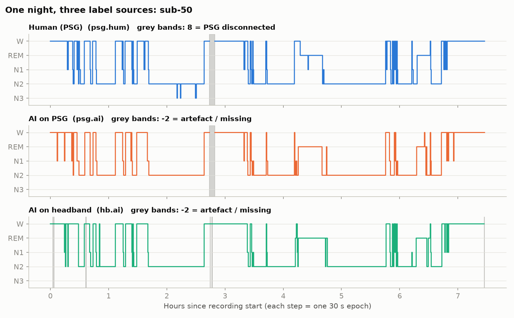
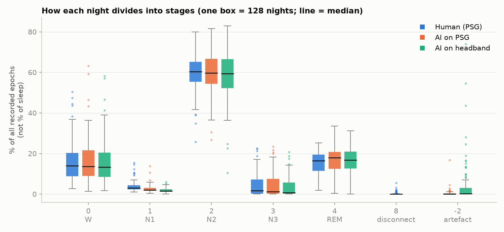
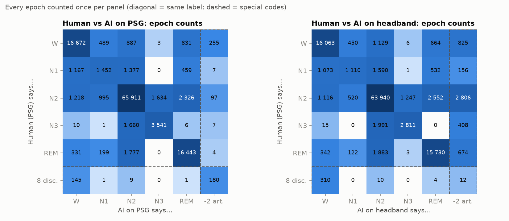
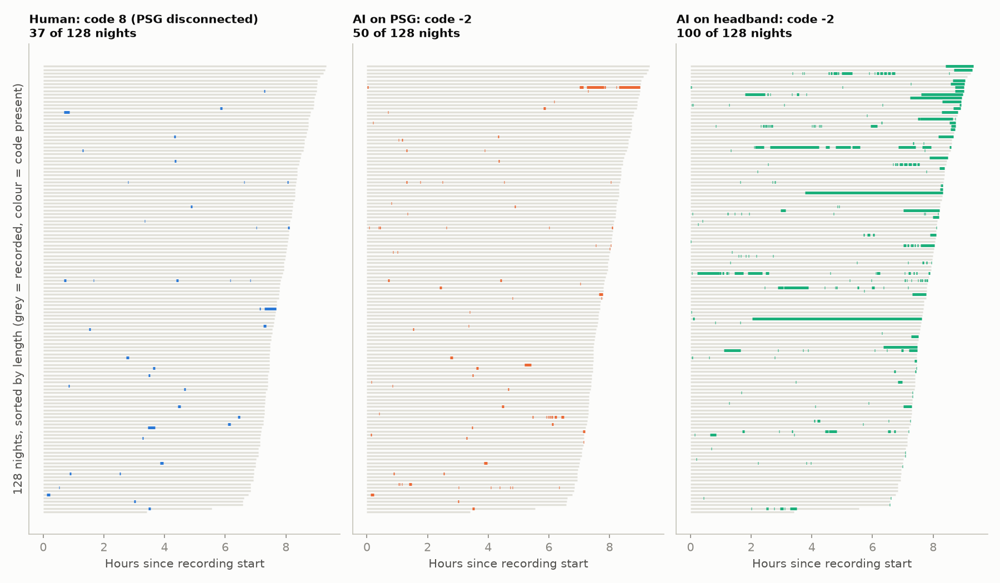

# BOAS data inventory

Read-only inspection of `data/boas/`. Nothing in that folder was modified or downloaded.

- **Dataset version:** 1.1.3 (`data/boas/CHANGES`; git tag `1.1.3`, commit `face095`, 2026-08-31). DOI `doi:10.18112/openneuro.ds005555.v1.1.3`, BIDS 1.8.0, HED 8.4.0, licence CC0 (`data/boas/dataset_description.json`).
- **Generated by:** FieldTrip `data2bids` (`dataset_description.json` → `GeneratedBy`).
- **Inspected on:** 2026-10-24. Counts were computed over all 128 `sub-*` folders. Every check behind sections 2–8 is reproduced by `uv run python -m boas_unc.audit_inventory`. It writes `results/inventory_audit.json` and fails if the files and this document disagree. Section 0's figures and numbers come from `src/boas_unc/inventory_figures.py`, which writes `results/inventory_counts.json`.
- **EDF signals are not present locally.** All 256 `*_eeg.edf` files are git-annex symlinks with no content behind them (e.g. `sub-1/eeg/sub-1_task-Sleep_acq-psg_eeg.edf` → `.git/annex/objects/…`, size 154 652 160 B per the annex key). Nothing in this inventory reads signal data.

## 0. Primer: what this data is and how to read the numbers

This section is background for a first read. Sections 1–9 are the strict inventory.

There are three kinds of claims here, and each is tagged:
- **[dataset]**: read from the files. Each one names its source.
- **[computed]**: produced by `src/boas_unc/inventory_figures.py`. The numbers are stored in `results/inventory_counts.json`.
- **[background]**: general sleep-science knowledge, not taken from this dataset. These are textbook approximations. Check the original source before quoting one in `REPORT.md`.

### 0.1 What was recorded

A **polysomnography (PSG)** is the clinical sleep test. Sensors are glued to the head and body overnight, and a trained technician scores the recording afterwards [background]. The three signals that matter most for staging are:

| Signal | What it measures | Why stagers need it [background] |
|---|---|---|
| **EEG** (electroencephalogram) | Brain electrical activity at the scalp (here F3, F4, C3, C4, O1, O2) | Shows the brain-wave pattern that defines each stage |
| **EOG** (electro-oculogram) | Eye movements | Rapid eye movements are the signature of REM. Slow rolling eye movements mark drowsiness and N1 |
| **EMG** (electromyogram, chin) | Muscle tone | Muscle tone drops to its lowest in REM. This is the main thing that tells REM apart from wake or N1 |

In this dataset, every night was recorded twice at the same time [dataset, `README`]:
- by a clinical **PSG** (Micromed), which has EEG, EOG and EMG plus breathing and pulse sensors;
- by a **headband** (Bitbrain IKON Sleep), which has two forehead EEG channels (HB_1/HB_2, near AF7/AF8) and, on some nights, motion (IMU) and pulse sensors.

The headband has **no chin EMG and no dedicated EOG**. So the stages that depend on muscle tone and eye movements (REM, and telling wake from N1) are the ones you'd expect it to find hardest [background; to be tested in Milestone 4]. The forehead electrodes are close to the eyes and do pick up some eye-movement activity, so this is a handicap rather than total blindness [background].

### 0.2 Epochs: the unit of everything

Scorers don't label continuous time. They cut the night into **30-second epochs** and give each epoch one label [dataset, `*_events.json`: "always 30"]. That is the AASM convention [background].

- A 7.8-hour night (the median here) has about 935 epochs. Nights in this dataset run from 3.4 to 9.3 h [computed].
- One row in a `*_events.tsv` file is one epoch. 120 095 rows means 120 095 thirty-second epochs, about 1 000 hours of sleep, across 128 nights [computed].
- Every count in this document is a **number of epochs** unless it says otherwise. To convert to minutes, multiply by 0.5.

### 0.3 The stage codes (0, 1, 2, 3, 4, 8, -2)

The codes are **category labels, not quantities**. Never average them: a mean stage of 2.3 means nothing. They come from `README` [dataset].

| Code | Stage | What the scorer looks for [background, AASM] | Rough share of sleep in healthy adults [background] |
|---|---|---|---|
| **0** | **W**, wake | Alpha rhythm (8–12 Hz) with eyes closed, eye blinks, high muscle tone | — (not sleep) |
| **1** | **N1**, light sleep | Alpha fades, slower theta (4–7 Hz), slow rolling eyes, vertex waves. A short transitional stage that scorers often disagree on | ~2–5 % |
| **2** | **N2** | **Sleep spindles** (11–16 Hz bursts) and **K-complexes** (large single slow waves) | ~45–55 % |
| **3** | **N3**, deep / slow-wave sleep | Epochs where ≥20 % of the time is high-amplitude slow waves (0.5–2 Hz, >75 µV) | ~13–23 % in young adults, falling strongly with age |
| **4** | **REM** | Low-amplitude mixed EEG, **rapid eye movements**, **minimal chin EMG** (muscle atonia). Most dreaming happens here | ~20–25 % |
| **8** | *not a stage*: **PSG disconnected** | Human labels only. The PSG was unplugged, e.g. for a bathroom break [dataset] | — |
| **-2** | *not a stage*: **artefact / missing data** | AI labels only. The model judged the signal unusable [dataset] | — |

**Trap: code 4 is REM, not "stage 4".** The older Rechtschaffen & Kales (1968) system had sleep stages S1–S4 plus REM. In 2007 the AASM merged S3 and S4 into a single N3 [background]. In this dataset, `3` is all of deep sleep and `4` is REM [dataset, `README`].

**8 and -2 are flags, not stages.**
- `8` means the human scorers had no PSG signal to score.
- `-2` means the AI chose not to give a stage.

Because neither is a stage, they need an explicit handling rule (drop the epoch, count it as wake, or count it as an error) before computing any agreement or sleep metric. See open questions 2–3.

Sources for the [background] rows: the AASM Scoring Manual (Berry et al., cited in `README`), and the stage-share ranges in Carskadon & Dement, *Normal Human Sleep* (Principles and Practice of Sleep Medicine). The decline of N3 with age is described in Ohayon et al., *Sleep* 27:1255 (2004).

### 0.4 A night drawn as a hypnogram

A **hypnogram** plots the stage over the night. By convention, Wake is at the top and deep sleep (N3) at the bottom [background]. Figure 1 shows one night (`sub-50`) three times, once per label source [computed]. This night was picked automatically as the median-length night that contains all three special codes.



How to read it:
- The three traces mostly overlap. Where they differ, the label sources **disagree**, and this project is about measuring those disagreements.
- Most of the night is spent in N2. REM comes in blocks, mostly in the second half of the night, which is the typical pattern [background].
- The grey band at about 2.75 h appears in two traces:
  - In the top trace, the human scorers marked it `8`, meaning the PSG was disconnected.
  - In the middle trace, the PSG AI marked the same stretch `-2`, meaning artefact. The two agree that there was no usable signal.
- The headband (bottom trace) shows a few thin grey `-2` slivers of its own, plus a real stage during the PSG gap. The headband kept recording while the PSG was unplugged.
- This night has only a few epochs of N3. That is common in this dataset (section 0.6).

### 0.5 The three label columns: who said what

| Column (file) | Who labelled it | Looking at which signals | Role in this project |
|---|---|---|---|
| `stage_hum` (`*_acq-psg_events.tsv`) | Consensus of 3 human experts (a 4th breaks ties) | PSG | **Reference ("truth")** |
| `stage_ai` (`*_acq-psg_events.tsv`) | Bitbrain's AI model | PSG | Comparison or analysis tool; not available on the device |
| `stage_ai` (`*_acq-headband_events.tsv`) | The same kind of AI model, trained separately | Headband only | **What a home user would get**, the thing under test |

Sources: `*_events.json` and `README` [dataset].

The human "truth" is itself imperfect. Expert scorers agree with each other on only about 82 % of epochs [dataset, `README`, citing Rosenberg & Van Hout 2013]. So no method can be expected to match the humans 100 %. Agreement in the high 80s is close to the human-to-human ceiling. `README` reports 87.13 % (PSG AI) and 86.71 % (headband AI) against the human labels; Milestone 3 must reproduce these.

### 0.6 How much of each stage per night



How to read a box: each box summarises **128 nights**. The middle line is the median night. The box covers the middle 50 % of nights (the interquartile range, IQR). The whiskers and dots show the spread and the unusual nights [computed].

Takeaways:
- **The three sources tell a similar overall story.** Median W is 13–14 %, N2 59–60 % and REM 16–18 % of the night for all three.
- **N1 shrinks from human to PSG AI to headband AI:** medians of 3.1 %, 2.1 % and 1.5 % of the night. The AI, especially on the headband, labels N1 less often than the humans do.
- **N3 is scarce.** Figure 2's boxes divide by **all recorded epochs**: wake, `8` and `-2` included. In that figure the median night has 1.65 % N3. The textbook ranges divide by **sleep only** (N1–REM), so compare like with like:
  - As a share of sleep, the median human-scored night has 2.03 % N3. Pooled over all nights, N3 is 5.2 % of sleep and N2 is 71.7 %.
  - **37 of 128 nights have no N3 at all.**
  - That is well below the textbook ~13–23 % for N3, and above the ~45–55 % for N2 [computed vs background].
  - Age explains much of the gap: N3 falls from a 7.7 % median at ages 18–29 to 0 % at 60+, and 22 of the 37 nights with no N3 are from people aged 60+. Even the youngest group is low, though. See `CHECKLIST.md` A8.
- **The headband's `-2` share has a long tail.** Most nights have very little (median 0.23 %), but a few nights lose 15–74 %.

### 0.7 Reading the cross-tabulations (where "180" comes from)

A **cross-tabulation** puts every epoch into a cell of a grid: its row is what the humans said, and its column is what the AI said. Each panel of Figure 3 counts all 120 095 epochs exactly once [computed].



- **The diagonal** (W/W, N1/N1, …) holds the epochs where the human and the AI **agree**. For example, the 65 911 in the left panel are epochs both called N2.
- **Off-diagonal cells are disagreements.** The 1 777 in the left panel's REM row and N2 column are epochs the humans scored REM but the PSG AI called N2.
- **The dashed row and column are the special codes.** These are the "8 → -2: 180"-style numbers in section 5:
  - **180** epochs (bottom-right of the left panel): the humans said the PSG was disconnected (`8`) and the PSG AI said artefact (`-2`). Both agree there's no usable signal. This is the expected case.
  - **145** (bottom-left of the left panel): humans said disconnected, but the PSG AI still gave **Wake**. The AI produced a stage where humans saw no PSG. That's plausible if the person was up and walking around while partly connected, and it is why code 8 needs a handling rule.
  - **255** (top-right of the left panel): humans scored **Wake**, but the PSG AI said artefact. Movement while awake makes noisy signals.
  - **Right panel, `-2` column** (825, 156, 2 806, 408, 674): epochs where the human gave a real stage but the **headband** AI gave up. Together they make the "4 869 headband `-2` epochs have a real human stage" in section 5. These epochs are the main reason the `-2` rule matters for headband agreement.
  - **Right panel, `8` row** (310 W, 10 N2, 4 REM, 12 `-2`): while the PSG was unplugged, the headband kept recording and usually saw **Wake**. That fits a bathroom break.
- The colour scale is **logarithmic**, so cells of 10 and 10 000 are both visible. Darker means more epochs.

These are raw counts only. Agreement metrics (accuracy, Cohen's kappa, per-stage F1) come in Milestone 3, once the rules for codes 8 and -2 are decided.

### 0.8 Where the special codes happen in the night



Each grey line is one night, drawn to its length and sorted from shortest (bottom) to longest (top). Coloured marks show where the code occurs [computed].

- **Human `8`** (37 nights) appears as short, scattered gaps mid-night, which fits bathroom breaks. The median run is 6 epochs, i.e. 3 min (section 5).
- **PSG AI `-2`** (50 nights) is mostly 1–2-epoch blips, with a few longer stretches.
- **Headband AI `-2`** (100 nights) is a different pattern. There are many blips, but also long blocks, especially **at the very end of the longest nights**. Of the 4 881 headband `-2` epochs, **2 928 (60 %) are in runs that last until the end of the recording** [computed]. That suggests the headband stopping or coming off in the morning rather than artefacts during sleep. See open question 16.

### 0.9 Mini-glossary

| Term | Meaning |
|---|---|
| **Epoch** | A 30 s window with one label. One row of an events file |
| **Hypnogram** | A plot of stage over the night (Figure 1) |
| **Consensus label** | The label at least 2 of the 3 human scorers chose (`stage_hum`) |
| **Artefact** | Signal corruption from something other than the brain: movement, sweat, a loose electrode |
| **Sidecar** | A `.json` file next to a data file that describes its columns (BIDS convention) |
| **BIDS** | Brain Imaging Data Structure, the standard folder and file-naming scheme used here |
| **`sub-N`** | One **night** (recording), not one person. People are identified by `pid` (section 7) |
| **onset / begsample / endsample** | Epoch start in seconds, and its first and last sample at 256 Hz |
| **Cross-tabulation / confusion matrix** | The grid of label pairs in Figure 3. "Confusion matrix" is the usual name when one axis is treated as the truth |
| **Median / IQR** | The middle value, and the range covering the middle 50 % of nights. the project rules ask for these per night rather than pooled averages |

### 0.10 Abbreviations

The metric definitions below are the ones this project uses, locked in `docs/definitions.md` (decisions D1–D11 in `CHECKLIST.md`). Where the textbook meaning is wider, it says so [background].

**Sleep metrics**

| Abbreviation | Stands for | Meaning here |
|---|---|---|
| **TIB** | Time in bed | The whole recording, start to end, in minutes, minus the epochs the humans marked `8` (PSG disconnected). There are no lights-off/on markers in the files, so the recording length stands in for the time the person was in bed |
| **TIB_matched** | Time in bed, matched epochs | Only the epochs where both the human and the headband gave a stage 0–4, times 30 s. Used only in the "matched-epoch" analysis, so that headband dropout doesn't shrink sleep efficiency |
| **TST** | Total sleep time | Minutes spent in N1, N2, N3 or REM |
| **SE** | Sleep efficiency | 100 × TST / TIB. The share of the time in bed spent asleep |
| **SOL** | Sleep onset latency | Minutes from the start of the recording to the first sleep epoch (any of N1, N2, N3, REM) |
| **WASO** | Wake after sleep onset | Minutes of Wake between falling asleep and the **last sleep epoch**. Waking at night counts; the wake time after the final awakening does not |
| **Terminal wake** | (not an abbreviation) | Minutes of Wake after the last sleep epoch until the recording ends. Reported separately, so that WASO doesn't depend on when someone stopped the recording |
| **REM latency** | | Minutes from sleep onset (not from the recording start) to the first REM epoch |
| **Pre-sleep wake** | | Wake epochs before the first sleep epoch, in minutes |
| **Unscored** | | Headband `-2` epochs: neither sleep nor wake. They stay inside TIB |

How they fit together, for one night in the standalone analysis:
`TIB = pre-sleep wake + TST + WASO + terminal wake + unscored`. Pre-sleep wake is the Wake before the first sleep epoch. It is not the same as SOL whenever a disconnection (`8`) or artefact (`-2`) falls before sleep onset, because SOL is a plain clock difference.

**Sleep stages and scoring**

| Abbreviation | Stands for | Meaning |
|---|---|---|
| **W** | Wake | Code `0` |
| **N1, N2, N3** | Non-REM stages 1, 2, 3 | Codes `1`, `2`, `3`. N3 is deep sleep (section 0.3) |
| **REM** | Rapid eye movement sleep | Code `4`. Not "stage 4" (section 0.3) |
| **NREM** | Non-REM | N1, N2 and N3 together |
| **AASM** | American Academy of Sleep Medicine | The body whose scoring manual sets the 30 s epoch, the stage names and the standard sleep metrics [background] |

**Signals and devices**

| Abbreviation | Stands for | Meaning |
|---|---|---|
| **PSG** | Polysomnography | The clinical sleep test, here recorded with a Micromed system |
| **HB** | Headband | The Bitbrain IKON Sleep headband. Appears in column names as `hb_ai` |
| **EEG, EOG, EMG** | Electro-encephalogram, -oculogram, -myogram | Brain activity, eye movements, chin muscle tone (section 0.1) |
| **IMU** | Inertial measurement unit | The headband's motion sensor |
| **EDF** | European Data Format | The file format of the raw signals. Not downloaded in this phase |

**Labels, as written in the code and the results files**

| Name | Meaning |
|---|---|
| **`psg_hum`** (`stage_hum` in the files) | Human consensus label on the PSG. The reference |
| **`psg_ai`** | Bitbrain's AI label computed from the PSG |
| **`hb_ai`** | Bitbrain's AI label computed from the headband |
| **AI** | In this project, always Bitbrain's shipped labels. No model is trained in Phase 0 |

**Statistics**

| Abbreviation | Stands for | Meaning |
|---|---|---|
| **IQR** | Interquartile range | The range covering the middle 50 % of nights, reported as 25th to 75th percentile |
| **κ (kappa)** | Cohen's kappa | Agreement between two label sequences, corrected for the agreement expected by chance. 1 is perfect, 0 is chance level |
| **F1** | | For one stage, the harmonic mean of precision (of the epochs predicted as this stage, how many are right) and recall (of the epochs that are this stage, how many were found) |
| **NaN** | Not a number | "Undefined". Used instead of 0 when a metric can't be computed, for example REM latency on a night without REM |
| **LoA** | Limits of agreement | In a Bland–Altman comparison, the range expected to contain 95 % of the differences between the two methods (mean difference ± 1.96 SD) |
| **pid** | Participant identifier | One person. A person can have several nights (`sub-N`), see section 8 |

Regenerate the figures and `results/inventory_counts.json` with:
`uv run python src/boas_unc/inventory_figures.py`

## 1. Top-level files

| File | Content |
|---|---|
| `README` | Dataset description, channel groups, **stage code table** |
| `CHANGES` | Version history 1.0.0 → 1.1.3 |
| `dataset_description.json` | BIDS metadata (authors, DOI, licence, ethics) |
| `participants.tsv` / `participants.json` | One row per recording: `participant_id age sex bmi pid` |
| `channels.tsv` / `channels.json` | One row per recording (`REC`), 0/1 flag per channel group |
| `.bidsignore` | Contains `channels.tsv` (the top-level file isn't standard BIDS) |
| `.gitattributes`, `.datalad/`, `.git/` | DataLad / git-annex plumbing |
| `sub-1` … `sub-128` | 128 recording folders |

## 2. Folder structure (two example recordings)

All 128 folders contain the same 11 files. Only the subject label changes (verified by counting each file suffix: 128 of each).

```
sub-1/
├── sub-1_scans.tsv
└── eeg/
    ├── sub-1_task-Sleep_acq-psg_eeg.edf            (annex symlink, not downloaded)
    ├── sub-1_task-Sleep_acq-psg_eeg.json
    ├── sub-1_task-Sleep_acq-psg_channels.tsv
    ├── sub-1_task-Sleep_acq-psg_events.tsv
    ├── sub-1_task-Sleep_acq-psg_events.json
    ├── sub-1_task-Sleep_acq-headband_eeg.edf       (annex symlink, not downloaded)
    ├── sub-1_task-Sleep_acq-headband_eeg.json
    ├── sub-1_task-Sleep_acq-headband_channels.tsv
    ├── sub-1_task-Sleep_acq-headband_events.tsv
    └── sub-1_task-Sleep_acq-headband_events.json
sub-100/
├── sub-100_scans.tsv
└── eeg/
    └── (same 10 files with prefix sub-100_task-Sleep_acq-{psg,headband}_…)
```

There is no `ses-` level and no `run-` entity. The only entity that differs between the two devices is `acq-psg` vs `acq-headband`.

## 3. `*_events.tsv` types and columns

| File type | Columns (identical in all 128 files) |
|---|---|
| `*_acq-psg_events.tsv` | `onset  duration  begsample  endsample  offset  stage_hum  stage_ai` |
| `*_acq-headband_events.tsv` | `onset  duration  begsample  endsample  offset  stage_ai` |

Column meanings, quoted from `sub-*/eeg/*_acq-psg_events.json` and `*_acq-headband_events.json`. The key sets are identical in all 128 files of each type.

| Column | Sidecar description |
|---|---|
| `onset` | "Start of epoch in seconds" |
| `duration` | "Duration of epoch in seconds (always 30)" |
| `begsample` | "Start of epoch in samples" |
| `endsample` | "End of epoch in samples" |
| `offset` | "Offset of marker to epoch start (always 0, artifact of using Fieldtrip BIDS export)" |
| `stage_hum` (PSG only) | "Sleep stage of epoch according to the majority vote of 3 expert human scorers, based on PSG data" |
| `stage_ai` (PSG file) | "Sleep stage of epoch according to Bitbrain AI-based automatic scoring, based on PSG data" |
| `stage_ai` (headband file) | "Sleep stage of epoch according to Bitbrain AI-based automatic scoring, based on headband data" |

The sidecars give **no `Levels` mapping for the stage codes**. The codes are defined only in `README` (section 5).

Checks run against the data:
- `duration` = 30 in all 240 190 rows. `offset` = 0 in all rows.
- In every file, `onset` = 30·i exactly, `begsample` = 7680·i + 1, and `endsample` = 7680·(i+1). The samples are 1-based and inclusive: 7680 = 30 s × 256 Hz. There are no gaps or overlaps.

## 4. JSON sidecar types

| Sidecar | Keys | Values across the 128 files |
|---|---|---|
| `*_acq-psg_eeg.json` | EEGChannelCount, EEGReference, InstitutionAddress, InstitutionName, InstitutionalDepartmentName, Manufacturer, ManufacturersModelName, PowerLineFrequency, RecordingDuration, SamplingFrequency, SoftwareFilters, TaskDescription, TaskName | Manufacturer "Micromed", model "SD plus", SamplingFrequency 256, PowerLineFrequency 50, EEGReference "M1 (left mastoid)", SoftwareFilters "n/a". EEGChannelCount ∈ {8: 64, 9: 2, 11: 38, 12: 5, 13: 19}. RecordingDuration varies |
| `*_acq-headband_eeg.json` | same keys | Manufacturer "Bitbrain Technologies", model "IKON Sleep", SamplingFrequency 256, EEGChannelCount 2, EEGReference "M1 (left mastoid)" |
| `*_acq-psg_events.json` | onset, duration, begsample, endsample, offset, stage_hum, stage_ai | See section 3 |
| `*_acq-headband_events.json` | onset, duration, begsample, endsample, offset, stage_ai | See section 3 |
| `participants.json` | participant_id, age, sex, bmi, pid | sex Levels `F` = Female, `M` = Male. `participant_id` is "Recording ID…See 'pid' for unique participant identifier" |
| `channels.json` | PSG_EEG … HB_PULSE, REC | Each group flag: `0` = "Does not contain these channels", `1` = "Contains these channels" |

Other per-recording TSVs:
- `*_channels.tsv` columns are `name type units sampling_frequency`. Every channel is sampled at 256 Hz.
  - PSG channel names (exact `name` values, all prefixed `PSG_`) and the number of recordings that have them: `PSG_F3`, `PSG_F4`, `PSG_C3`, `PSG_C4`, `PSG_O1`, `PSG_O2` and `PSG_EMG` (128 each); `PSG_EOG` (102); `PSG_EOGL`/`PSG_EOGR` (26); `PSG_THER`, `PSG_THOR` and `PSG_ABD` (62); `PSG_CAN` (19); `PSG_PULSE`, `PSG_BEAT` and `PSG_SPO2` (104).
  - Headband channel names (prefixed `HB_`) and counts: `HB_1` and `HB_2` (128); `HB_IMU_1`–`HB_IMU_6` (94); `HB_PULSE` (112).
- `*_scans.tsv` has one column, `filename`, listing the psg EDF and then the headband EDF.
- The top-level `channels.tsv` group flags agree with the per-recording `*_channels.tsv` files in all 128 recordings (0 mismatches).

## 5. Label codes

Source: `data/boas/README`, section "Sleep staging labels".

| Code | Meaning (README) | Appears in |
|---|---|---|
| `0` | Wake | all three columns |
| `1` | NonREM stage 1 (N1) | all three |
| `2` | NonREM stage 2 (N2) | all three |
| `3` | NonREM stage 3 (N3) | all three |
| `4` | REM sleep | all three |
| `8` | "PSG disconnections (e.g., due to bathroom breaks; human-scored only)" | `stage_hum` only ✔ |
| `-2` | "Artifacts and missing data (AI-scored only)" | `stage_ai` only ✔ |

The README's statement that `8` is human-only and `-2` is AI-only holds in the data. `stage_hum` never contains `-2`, and neither `stage_ai` column contains `8`.

### Distinct values and counts (all 128 nights, 120 095 epochs per column)

| Code | `psg.stage_hum` | `psg.stage_ai` | `headband.stage_ai` |
|---|---:|---:|---:|
| 0 W | 19 137 | 19 543 | 18 919 |
| 1 N1 | 4 462 | 3 137 | 2 202 |
| 2 N2 | 72 181 | 71 621 | 70 543 |
| 3 N3 | 5 225 | 5 178 | 4 068 |
| 4 REM | 18 754 | 20 066 | 19 482 |
| 8 disconnect | 336 | — | — |
| -2 artefact/missing | — | 550 | 4 881 |
| **total** | 120 095 | 120 095 | 120 095 |

Number of nights in which each code appears at least once (out of 128):

| Code | `psg.stage_hum` | `psg.stage_ai` | `headband.stage_ai` |
|---|---:|---:|---:|
| 0, 1, 2 | 128 | 128 | 128 |
| 3 | 91 | 78 | 72 |
| 4 | 128 | 128 | 127 |
| 8 | 37 | — | — |
| -2 | — | 50 | 100 |

Where the special codes fall (runs of consecutive epochs):
- `stage_hum = 8`: 50 runs, 48 mid-night and 2 at the end of the night. Run length is 1–46 epochs, median 6.
- PSG `stage_ai = -2`: 115 runs (110 mid-night, 5 at the end). Length 1–85 epochs, median 2.
- Headband `stage_ai = -2`: 372 runs (302 mid-night, 64 at the end, 6 at the start). Length 1–670 epochs, median 1.

How the special codes line up across columns, epoch by epoch:
- PSG file, `stage_hum` vs `stage_ai`, for epochs where either is special:

  | stage_hum → stage_ai | Epochs |
  |---|---:|
  | 8 → -2 | 180 |
  | 8 → 0 | 145 |
  | 8 → 2 | 9 |
  | 8 → 1 | 1 |
  | 8 → 4 | 1 |
  | 0 → -2 | 255 |
  | 2 → -2 | 97 |
  | 1 → -2 | 7 |
  | 3 → -2 | 7 |
  | 4 → -2 | 4 |

- PSG `stage_hum` vs headband `stage_ai`: of the 4 881 headband `-2` epochs, 4 869 have a real sleep stage (0–4) in `stage_hum`. Of the 336 `stage_hum = 8` epochs, 310 are scored `0` by the headband AI.

## 6. Epoch length and timing

- **Epoch length is 30 s.** Sources: `*_events.json` ("always 30") and the `duration` column (30 in every row). AASM scoring is referenced in `README`.
- **Sampling rate is 256 Hz** for both devices (`*_eeg.json` `SamplingFrequency`, `*_channels.tsv`), giving 7680 samples per epoch.
- **Nights** are 409–1 119 epochs long (3.4–9.3 h), 120 095 epochs in total.
- `RecordingDuration` (in `*_eeg.json`, presumably seconds) − 30 × n_epochs is between 0 and 29 for every night. So the events cover the recording from t = 0, and only the trailing partial epoch is left out.

## 7. How PSG and headband files are paired

- **Pairing is by recording folder / `sub-<N>` label.** `sub-N_task-Sleep_acq-psg_*` pairs with `sub-N_task-Sleep_acq-headband_*`. `README` says "The folder of each recording contains the data recorded with the PSG … and with the wearable EEG headband", and both devices were "acquired simultaneously". `sub-N_scans.tsv` lists both EDFs.
- **Epoch alignment is row-for-row.** In all 128 recordings both events files have the same number of rows and identical `onset` columns. Both `*_eeg.json` files report the same `RecordingDuration`.
- **Labels come from different signals.**
  - `stage_hum` is the human consensus, scored on PSG.
  - PSG `stage_ai` is the AI model run on PSG.
  - Headband `stage_ai` is the AI model run on headband signals.
  - Human labels exist **only in the PSG events file**. To evaluate the headband you compare headband `stage_ai` against PSG `stage_hum` from the same `sub-N`, row by row.
- **`sub-N` is a recording (night), not a person.** `participants.json` describes `participant_id` as "Recording ID" and `pid` as "Unique participant identifier". There are 128 recordings from 100 unique `pid`s. 20 pids have more than one night:
  - 2 nights: 89, 91, 92, 93, 15, 86, 77–82
  - 3 nights: 83, 84, 87, 88, 96–99

  For example, pid 89 = sub-1 and sub-2, and pid 15 = sub-23 and sub-124. Any cross-validation or summary at the per-person level must group by `pid`.

## 8. Participants (`participants.tsv`)

- 128 rows: 76 F and 52 M (counted per recording, not per person). Age ranges 18–82 and BMI 18.3–33.3.
- Missing values: `sub-16` has age `n/a`, and `sub-29` has bmi `n/a`.
- pid 15 has different demographics on its two nights: sub-23 is (34, M, 28.1) and sub-124 is (35, M, 27.3). That fits with age and BMI being recorded per session ("Age at the time of the recording", `participants.json`).

## 9. Open questions / ambiguities

These questions are now tracked, and answered as they're resolved, in `CHECKLIST.md` at the repo root. Their numbers here are referenced there as `INV-n`. This list is a snapshot from the first inventory pass.

1. **Consensus rule.** `README` says each epoch got the label given by at least 2 of 3 scorers, and a **fourth scorer** decided three-way ties. `*_acq-psg_events.json` says only "majority vote of 3 expert human scorers". Which epochs went to the tie-breaker isn't recorded. Individual scorer labels aren't in the dataset, so inter-scorer uncertainty can't be computed per epoch.
2. **What `8` covers.** The README gives "PSG disconnections (e.g., due to bathroom breaks)". In the data, 145 of the 336 `8` epochs are scored Wake and 9 are scored N2 by the PSG AI. So the PSG signal may still be usable there. Should `8` be excluded, or treated as Wake, for total sleep time and wake after sleep onset?
3. **What `-2` covers.** The README says "Artifacts and missing data". It doesn't say how the model decides on `-2` (a threshold or a separate artefact detector), and it doesn't separate artefact from missing data. 4 869 headband `-2` epochs have a real human stage, and 6 nights start with headband `-2`. How should these epochs be counted in agreement metrics: dropped, or counted as errors?
4. **sub-1 starts in N3.** The first 37 epochs (18.5 min) of `sub-1` have `stage_hum = 3`. It's the only one of the 128 nights that doesn't start in Wake. Did recording or scoring start mid-sleep, or is this a labelling issue?
5. **Night ends.** 15 nights end in N2, 7 in REM and 2 in code 8. Lights-off and lights-on times aren't given anywhere, so time in bed has to be taken as the full recording.
6. **AI labels and cross-validation.** `README` says the model was "trained and validated separately on the PSG and wearable EEG datasets" with "a cross-validation procedure". It doesn't give the folds, or say whether the shipped `stage_ai` labels are out-of-fold predictions or whether folds were grouped by `pid`. If the labels are in-fold, or nights from the same person were split across folds, agreement with `stage_hum` is optimistic.
7. **AI label version.** `CHANGES` 1.1.1 says the AI labels were updated, with fewer than 0.3 % changed. Any published accuracy figures (87.13 % PSG, 86.71 % headband in `README`) may refer to the earlier labels.
8. **Model name mismatch.** The PSG device is called "Brain Quick Plus Evolution" in `README` but "SD plus" in `*_acq-psg_eeg.json` (`ManufacturersModelName`).
9. **Headband reference.** `*_acq-headband_eeg.json` gives `EEGReference` "M1 (left mastoid)". `README` puts the headband electrodes at ~AF7/AF8 and describes a forehead-only device. (Resolved 2026-10-27: the manufacturer's public documentation places the reference on the mastoids, so the sidecar is right. See CHECKLIST H2.) [earlier note, now superseded: this looked copied from the PSG sidecar and shouldn't be trusted.]
10. **`EEGChannelCount` doesn't match the channel files.** The value equals the number of `type = EEG` rows in `*_channels.tsv`. For PSG, those rows include EOG, EMG, THER, THOR, ABD and CAN, which aren't EEG. It doesn't equal the total row count in 104 PSG and 112 headband files. Use `*_channels.tsv` as the source of truth.
11. **Units.** `PSG_PULSE` has units "unknown", and `HB_PULSE` is in "nA" (`*_channels.tsv`).
12. **Citation year.** `README` cites "Esparza-Iaizzo et al., 2026" in the text, but the reference list gives "(2024)" with a 2026 DOI.
13. **`RecordingDuration` units.** Seconds are assumed. BIDS defines the field in seconds, and the values fit 30 s × epoch count, but the sidecar doesn't say.
14. **pid 15's two nights differ in demographics** (see section 8). Their sub numbers are far apart (23 vs 124). It's probably a re-visit, but this needs confirming before grouping by `pid`.
15. **Very little N3.** In the human labels, N3 is 5.2 % of sleep pooled, with a median of 1.65 % of the night, and 37 of 128 nights have none (`results/inventory_counts.json`). That is far below the textbook ~13–23 % (section 0.3). Is this explained by the participants' ages, or by the scoring practice? It matters because per-stage metrics for N3 will rest on few epochs and many nights with zero.
16. **Headband `-2` at the end of the night.** 2 928 of the 4 881 headband `-2` epochs (60 %) are in runs that continue to the end of the recording (`results/inventory_counts.json`, Figure 4). Is the headband switching off or being removed while the PSG keeps recording? If so, should those tail epochs count as "headband missing" rather than "artefact", and be excluded from time in bed for headband-based metrics?
